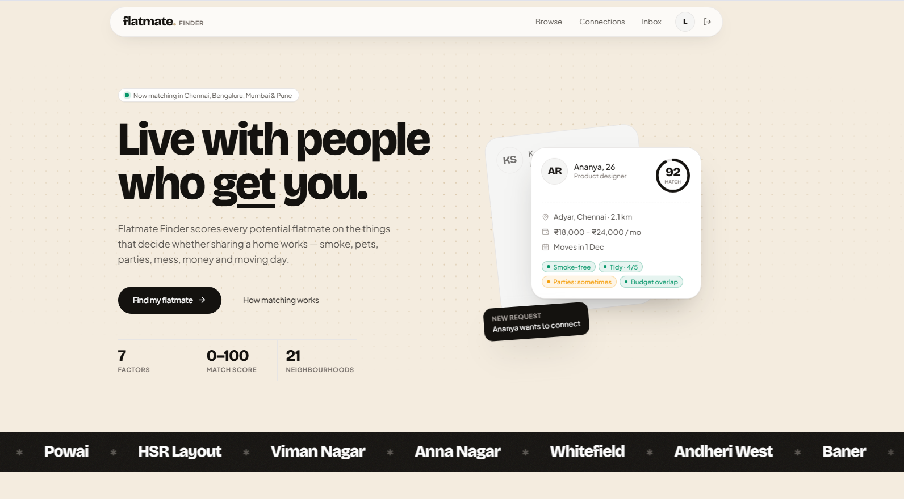
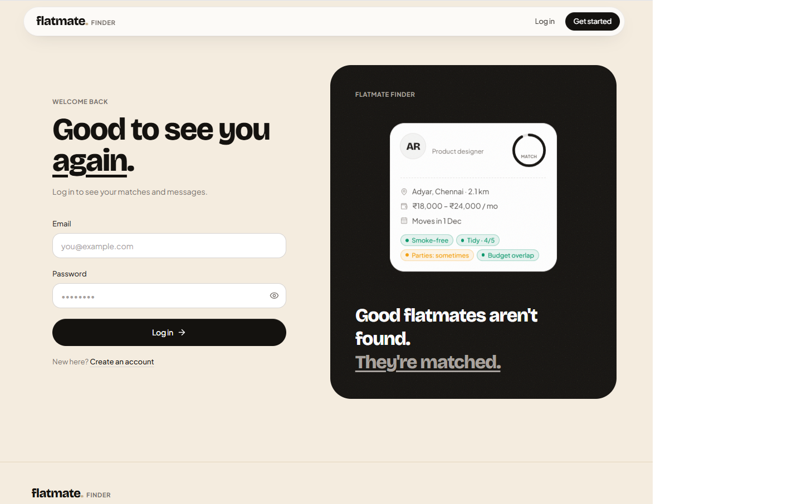
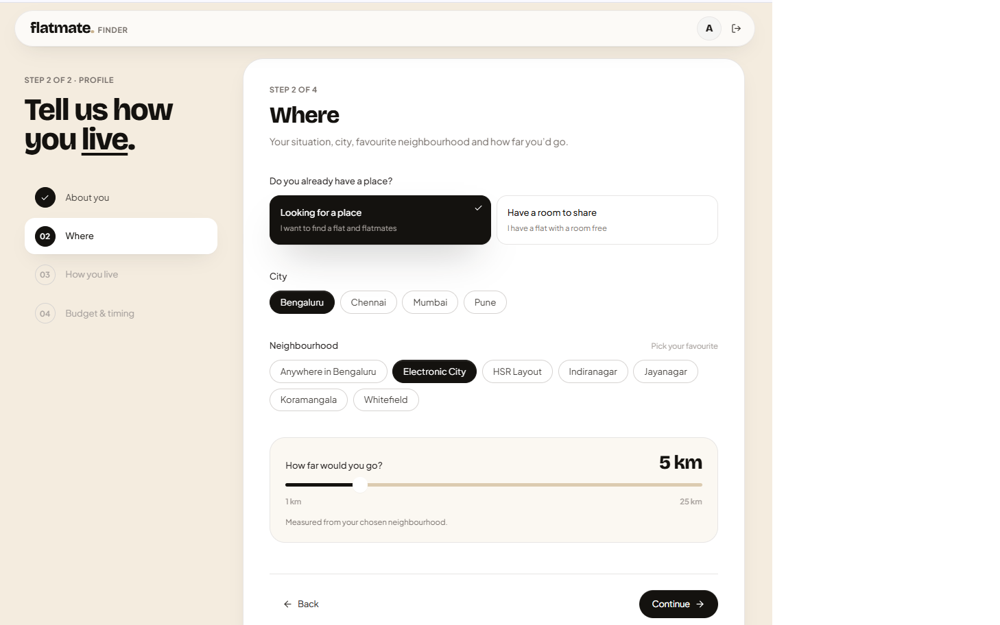
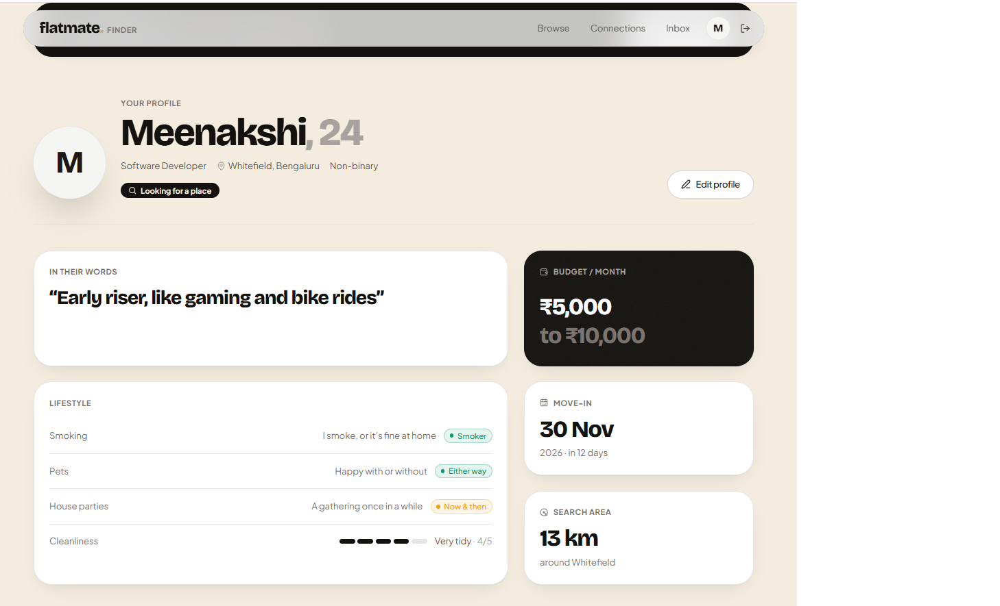
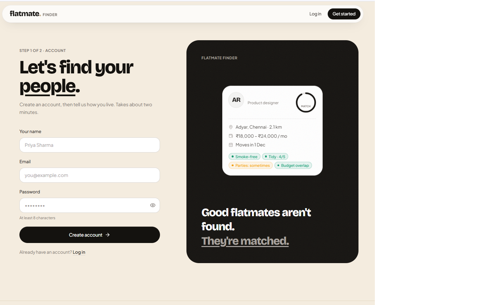
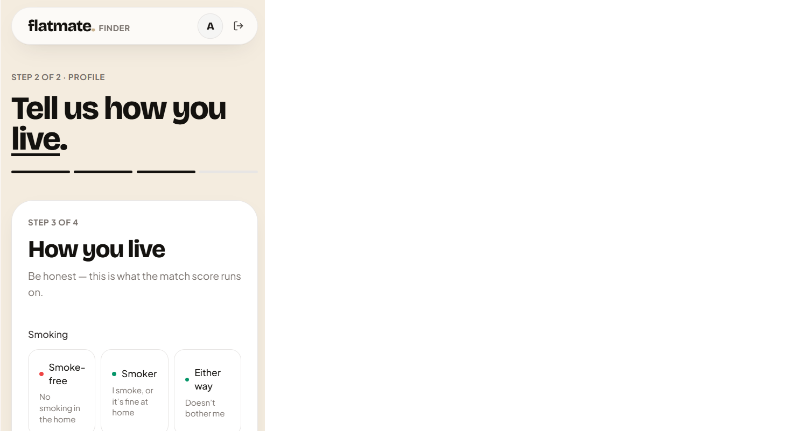

<div align="center">

# flatmate. <sub><sup>FINDER</sup></sub>

**Find a flatmate who fits your life.**
A full-stack web app that matches people on the things that decide whether sharing a home works —
smoking, pets, parties, cleanliness, budget, move-in date and location.


[Features](#-features) · [Screenshots](#-screenshots) · [Getting started](#-getting-started) · [API](#-api-reference) · [Architecture](#-architecture) · [Roadmap](#-roadmap)

</div>

---

## ✦ Overview

Flatmate Finder lets people build a lifestyle profile and get ranked against everyone else on a **0–100 match score**, with a clear per-factor breakdown showing where two people click and where they clash. It is built as a portfolio project to show end-to-end product work: data modelling, a REST API with validation and auth, and a carefully designed, accessible React UI.

## ✦ Features

| | Feature | Details |
|---|---|---|
| 🔐 | **Authentication** | Email + password sign-up/login, bcrypt hashing, JWT in an httpOnly cookie, rate-limited auth routes, live password-strength meter |
| 🧭 | **Guided onboarding** | 4-step profile wizard — About you → Where → How you live → Budget & timing — with per-step validation |
| 🏠 | **Lifestyle profiles** | Smoking (No / Yes / Flexible), Pets (No / Yes / Flexible), House parties (No / Occasionally / Flexible), Cleanliness (1–5), Budget range (₹), Move-in date |
| 🛏️ | **Seeking vs. offering** | Mark whether you're looking for a place or have a room to share — with separate **person** and **room** photos and live previews |
| 📍 | **Distance search** | 21 neighbourhoods with coordinates; Browse finds flatmates within 1–25 km using a Haversine query in MySQL and shows the exact distance (e.g. **2.1 km**) on every card |
| 🎯 | **Match score** | Weighted 7-factor score (0–100) on every card, preference filter pills, sort by best match / nearest / soonest, and a “How you match” breakdown on profiles |
| 🤝 | **Connections** | Send a request from any profile; accept or decline from the Connections page — messaging unlocks only once accepted |
| 💬 | **Real-time inbox** | Socket.IO chat with online/offline dots (green / gray), typing indicator, unread badges, “Seen” receipts, optimistic sending and history paging |


## ✦ Screenshots


| Landing page | Login page |
|---|---|
|  |  |

| Onboarding wizard | Profile page |
|---|---|
|  |  |

| Sign-up with password strength | Mobile view |
|---|---|
|  |  |

## ✦ Tech stack

| Layer | Technologies |
|---|---|
| **Client** | React 18, Vite 5, Tailwind CSS 3, React Router 6, TanStack Query 5, axios, lucide-react |
| **Server** | Node.js 20+, Express 5, mysql2 (pooled, parameterised SQL), zod 4, bcrypt, jsonwebtoken, express-rate-limit, Socket.IO |
| **Database** | MySQL 8 (utf8mb4 / InnoDB), hand-written SQL migrations — no ORM |
| **Testing** | Server: Node’s built-in test runner (`node --test`) against MySQL + live Socket.IO clients · Client: Vitest + jsdom + axe-core accessibility audit |

## ✦ Getting started

### Prerequisites

- **Node.js 20+** and npm
- **MySQL 8** running locally

### 1. Clone and install

```bash
git clone https://github.com/meenu10802/FlatMate_Finder.git
cd FlatMate_Finder

cd server && npm install
cd ../client && npm install
```

### 2. Configure the server

```bash
cd server
cp .env.example .env
```

Then edit `server/.env`:

| Variable | Example | Description |
|---|---|---|
| `PORT` | `4000` | API port |
| `DB_HOST` / `DB_PORT` | `localhost` / `3306` | MySQL connection |
| `DB_USER` / `DB_PASSWORD` | `root` / `…` | MySQL credentials |
| `DB_NAME` | `flatmate_finder` | Created automatically by the migration script |
| `JWT_SECRET` | *long random string* | Signs session tokens — generate with `node -e "console.log(require('crypto').randomBytes(48).toString('hex'))"` |
| `CLIENT_ORIGIN` | `http://localhost:5173` | Allowed CORS origin |

> `server/.env` takes precedence over machine-wide environment variables of the same name.

### 3. Create the database and seed data

```bash
# in /server
npm run migrate   # creates the DB (if needed) and applies db/migrations/*.sql in order
npm run seed      # 4 cities, 21 neighbourhoods and 9 sample flatmates
```

Both commands are idempotent — re-running `seed` resets the sample flatmates.

### 4. Run it

```bash
# terminal 1 — API on http://localhost:4000
cd server && npm run dev

# terminal 2 — web app on http://localhost:5173
cd client && npm run dev
```

Open **http://localhost:5173**, create an account and complete the profile wizard.

### Scripts

| Location | Command | What it does |
|---|---|---|
| `server/` | `npm run dev` | Start the API with nodemon |
| `server/` | `npm start` | Start the API |
| `server/` | `npm run migrate` | Apply pending SQL migrations |
| `server/` | `npm run seed` | Seed locations and sample flatmates |
| `server/` | `npm test` | Run the API test suite |
| `client/` | `npm run dev` | Start the Vite dev server (proxies `/api` → `:4000`) |
| `client/` | `npm run build` | Production build to `client/dist` |
| `client/` | `npm run preview` | Preview the production build |
| `client/` | `npm test` | Accessibility audit (axe-core) of every page + UX checks |

## ✦ API reference

Base URL: `/api`. Requests and responses are JSON in **camelCase**. Authenticated routes read the JWT from the `token` httpOnly cookie.

**Error format** (all endpoints):

```json
{ "error": { "code": "VALIDATION_ERROR", "message": "Invalid request", "details": { "fieldErrors": { "age": ["You must be 18 or older"] } } } }
```

### Health

| Method | Endpoint | Auth | Description |
|---|---|:---:|---|
| `GET` | `/health` | — | API and database status |

### Auth

| Method | Endpoint | Auth | Body | Description |
|---|---|:---:|---|---|
| `POST` | `/auth/register` | — | `{ name, email, password }` | Create an account and start a session · `201` · `409 EMAIL_TAKEN` |
| `POST` | `/auth/login` | — | `{ email, password }` | Start a session · `401 INVALID_CREDENTIALS` |
| `POST` | `/auth/logout` | — | — | Clear the session cookie · `204` |
| `GET` | `/auth/me` | ✓ | — | Current user, incl. `hasProfile` |

Register and login are rate-limited to **20 requests / 15 min per IP**.

### Profiles

| Method | Endpoint | Auth | Description |
|---|---|:---:|---|
| `GET` | `/profiles/me` | ✓ | Your profile · `404 PROFILE_NOT_FOUND` if not created yet |
| `PUT` | `/profiles/me` | ✓ | Create or replace your profile (see body below) |
| `GET` | `/profiles/:userId` | ✓ | Another user's active profile |

<details>
<summary><b><code>PUT /profiles/me</code> request body</b></summary>

| Field | Type | Rules |
|---|---|---|
| `age` | integer | 18–99, required |
| `gender`, `occupation` | string | optional |
| `bio` | string | optional, ≤ 1000 chars |
| `avatarUrl` | URL | optional — photo of the **person** |
| `hasRoom` | boolean | `true` = has a room to share |
| `roomPhotoUrl` | URL | optional — photo of the **room**; ignored unless `hasRoom` |
| `cityId` | integer | required, must exist |
| `areaId` | integer \| null | optional, must belong to `cityId` |
| `searchRadiusKm` | integer | 1–25, default 5 |
| `smoking`, `pets` | enum | `no` · `yes` · `flexible` |
| `parties` | enum | `no` · `occasionally` · `flexible` |
| `cleanliness` | integer | 1 (relaxed) – 5 (spotless) |
| `budgetMin`, `budgetMax` | integer (₹ / month) | `budgetMin ≤ budgetMax` |
| `moveInDate` | `YYYY-MM-DD` | required |

</details>

### Locations

| Method | Endpoint | Auth | Description |
|---|---|:---:|---|
| `GET` | `/locations/cities` | — | All cities with coordinates and area counts |
| `GET` | `/locations/cities/:id/areas` | — | Neighbourhoods in a city |

### Flatmates

| Method | Endpoint | Auth | Description |
|---|---|:---:|---|
| `GET` | `/flatmates` | ✓ | Flatmates within a radius, filtered by preferences, each with `distanceKm`, a 0–100 `score` and a 7-factor `breakdown` |

| Query param | Type | Default | Description |
|---|---|---|---|
| `areaId` | integer | your neighbourhood | Measure distance from this neighbourhood's centre |
| `cityId` | integer | your city | Measure from the city centre (when no `areaId`) |
| `radiusKm` | integer 1–25 | your profile radius | Maximum distance |
| `smoking`, `pets`, `parties` | comma list | any | Only people with one of these values, e.g. `smoking=no,flexible` |
| `budgetMax` | integer (₹) | any | Only people whose budget starts at or below this |
| `moveInBefore` | `YYYY-MM-DD` | any | Only people moving in on or before this date |
| `hasRoom` | `true` / `false` | any | Has a room to share / also looking |
| `minScore` | integer 0–100 | — | Hide matches below this score |
| `sort` | `match` · `distance` · `moveIn` | `match` | Result order |
| `page`, `limit` | integer | `1`, `24` (max 50) | Pagination |

<details>
<summary><b>Example response</b></summary>

```json
{
  "flatmates": [
    { "userId": 6, "name": "Ananya Rao", "age": 26, "area": { "id": 1, "name": "Adyar" }, "city": { "id": 1, "name": "Chennai" },
      "smoking": "no", "pets": "flexible", "parties": "occasionally", "cleanliness": 4,
      "budgetMin": 15000, "budgetMax": 24000, "moveInDate": "2026-12-02", "hasRoom": true, "distanceKm": 5,
      "score": 69,
      "breakdown": [
        { "factor": "budget", "label": "Budget", "score": 0.625, "weight": 20, "points": 12.5, "status": "partial", "detail": "Budgets overlap by ₹5,000" },
        { "factor": "smoking", "label": "Smoking", "score": 1, "weight": 15, "points": 15, "status": "match", "detail": "You’re both smoke-free" }
      ] }
  ],
  "origin": { "type": "area", "name": "Velachery", "lat": 12.9791, "lng": 80.2212 },
  "radiusKm": 25, "sort": "match", "page": 1, "limit": 24, "total": 2, "hasMore": false
}
```

</details>

Distances are great-circle (Haversine) distances between neighbourhood centres, computed in SQL:

```sql
6371 * 2 * ASIN(SQRT(
  POWER(SIN(RADIANS(lat - :originLat) / 2), 2) +
  COS(RADIANS(:originLat)) * COS(RADIANS(lat)) * POWER(SIN(RADIANS(lng - :originLng) / 2), 2)
)) AS distance_km
```

### Connections

| Method | Endpoint | Auth | Description |
|---|---|:---:|---|
| `GET` | `/connections` | ✓ | `{ incoming, outgoing, accepted }` — pending requests both ways and accepted connections (with `user.online`) |
| `GET` | `/connections/with/:userId` | ✓ | Your connection with one person, or `null` |
| `POST` | `/connections` | ✓ | `{ addresseeId }` — send a request (auto-accepts if they already asked you) · `201` |
| `PATCH` | `/connections/:id` | ✓ | `{ status: "accepted" \| "declined" }` — only the recipient, only while pending |

### Conversations & messages

A conversation is identified by its **accepted connection's id**.

| Method | Endpoint | Auth | Description |
|---|---|:---:|---|
| `GET` | `/conversations` | ✓ | Your threads with `lastMessage`, `unread` count and the other person's `online` status |
| `GET` | `/conversations/:connectionId/messages` | ✓ | History, oldest → newest; `?before=<messageId>&limit=50` for older pages · `hasMore` |
| `POST` | `/conversations/:connectionId/messages` | ✓ | `{ body }` (1–2000 chars) — REST fallback; the app sends over the socket |
| `POST` | `/conversations/:connectionId/read` | ✓ | Mark the other person's messages as read |

Messaging a connection that isn't accepted returns `403 NOT_CONNECTED`; someone else's thread returns `404`.

### Socket.IO events

The socket authenticates with the same session cookie (unauthenticated connections get `connect_error: UNAUTHENTICATED`).

| Direction | Event | Payload | Notes |
|---|---|---|---|
| client → server | `message:send` | `{ connectionId, body }` | Ack `{ ok, data: message }` · max 20 / 10 s |
| client → server | `message:read` | `{ connectionId }` | Ack `{ ok, data: { readAt } }` |
| client → server | `typing` | `{ connectionId, isTyping }` | Forwarded to the other person |
| server → client | `message:new` | message | Sent to both people (all their tabs) |
| server → client | `message:read` | `{ connectionId, readerId, readAt }` | Drives “Seen” and clears unread badges across tabs |
| server → client | `typing` | `{ connectionId, userId, isTyping }` | |
| server → client | `presence:list` | `[userId]` | Your online connections, on connect |
| server → client | `presence:update` | `{ userId, online }` | A connection came online / went offline |
| server → client | `connection:update` | `{ id, status }` | A request was sent, accepted or declined |


## ✦ Architecture

```
client/ (React + Vite)          server/ (Express)                       MySQL
───────────────────────         ──────────────────────────────          ──────────
pages ─▶ api/* (axios) ──/api──▶ routes ─▶ validate (zod)
         TanStack Query                    ─▶ controllers ─▶ services ─▶ models ─▶ tables
                                           requireAuth (JWT cookie)
```

```
FlatMate_Finder/
├── client/
│   └── src/
│       ├── api/          # axios client + per-resource calls & query hooks
│       ├── components/   # ui/ (design system), layout/, profile/, matches/
│       ├── context/      # AuthContext
│       ├── lib/          # constants, formatting, statusColor, passwordStrength
│       └── pages/        # Landing, AuthForm, Onboarding, MyProfile, EditProfile, ProfileView
├── server/
│   ├── db/
│   │   ├── migrations/   # 001_init, 002_room_listing, 003_messages_on_connections
│   │   └── seeds/        # cities & areas (SQL), sample flatmates (JS)
│   ├── src/
│   │   ├── config/       # env, MySQL pool
│   │   ├── routes/ controllers/ services/ models/
│   │   ├── middleware/   # requireAuth, validate, errorHandler
│   │   └── validators/   # zod schemas
│   └── test/             # node --test suites
└── CLAUDE.md             # architecture & design-system notes
```

### Data model

`users` 1—1 `profiles` · `cities` 1—n `areas` · `connections` (requester → addressee, `pending | accepted | declined`) 1—n `messages` (a chat thread is an **accepted** connection). The full schema is in [`server/db/migrations`](server/db/migrations) and documented in [`CLAUDE.md`](CLAUDE.md).

### Match score

Each candidate is scored 0–100 against your profile:

| Factor | Weight | Rule |
|---|---:|---|
| Budget | 20 | Overlap of the two rent ranges ÷ the smaller range |
| Smoking | 15 | Same → full · either *flexible* → 70% · yes vs no → 0 |
| Pets | 15 | Same as smoking |
| Parties | 15 | Same → full · *flexible* → 70% · *occasionally* vs *no* → 40% |
| Cleanliness | 15 | `1 − |a − b| / 4` |
| Move-in date | 10 | ≤ 14 days apart → full, linear decay to 0 at 90 days |
| Location | 10 | Same area → full, otherwise decays with distance up to your radius |

Factors scoring ≥ 85% are a **match**, 35–85% **partial**, below 35% a **conflict**.

## ✦ Security notes

- Passwords hashed with bcrypt (cost 12); login is timing-safe against email enumeration.
- Sessions are JWTs in `httpOnly`, `SameSite=Lax` cookies (`Secure` in production).
- Every write is validated with zod; all SQL is parameterised.
- Auth endpoints are rate-limited. Seeded sample accounts get random, never-revealed passwords, so they cannot be logged into.

## ✦ Roadmap

- [x] **Phase 1** — Scaffold: Vite + Tailwind (restricted palette), Express, MySQL migrations & seeds
- [x] **Phase 2** — Auth: register / login / logout, JWT cookie, protected routes
- [x] **Phase 3** — Profiles: onboarding wizard, profile & edit pages, locations API, room listings
- [x] **Phase 4a** — Browse page with Haversine distance search, location filter and radius slider (URL-synced)
- [x] **Phase 4b** — Preference filter pills (smoking, pets, parties, budget, move-in, room, min match) with removable chips
- [x] **Phase 5** — Match score (0–100) on every card and a “How you match” breakdown on profiles
- [x] **Phase 6** — Connection requests (connect, accept / decline)
- [x] **Phase 7** — Real-time inbox over Socket.IO: presence dots, typing, unread badges, read receipts
- [x] **Phase 8** — Polish: mobile menu, WCAG AA contrast fixes, skip link, page titles, 404 page, error boundary, axe-core audit

## ✦ Author

<table>
  <tr>
    <td>
      <b>Meenakshi Kalimuthu</b><br />
      Designed and built Flatmate Finder end to end.<br /><br />
      <a href="https://github.com/meenu10802">GitHub · @meenu10802</a><br />
      <a href="https://www.linkedin.com/in/meenu-chettiar/">LinkedIn · meenu-chettiar</a>
    </td>
  </tr>
</table>

If you have feedback or would like to talk about this project, feel free to reach out on LinkedIn.
